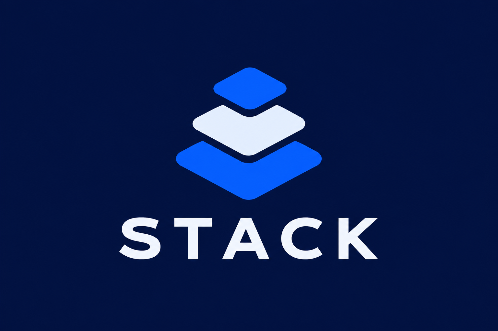

# Stack

**An iOS project exploring simpler crypto onboarding and portfolio discovery.**

Stack began with the idea of making small, regular investing approachable.
The iOS prototype explores onboarding, a risk questionnaire, portfolio matching
and wallet sign-in experiments using Sui testnet and zkLogin.

## Project status

Prototype. This is the public project showcase; the older app source and its
development history remain private. Bank linking, automatic round-ups and
production investing are product goals, not verified working features.

## Areas of work

- A clear native iOS onboarding experience.
- Portfolio discovery and matching interfaces.
- Wallet sign-in experiments on testnet.

No App Store release or production financial service is announced here.
